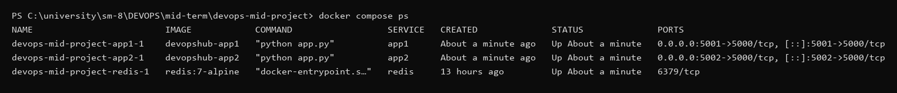
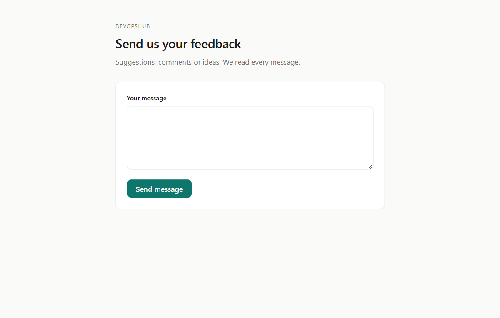
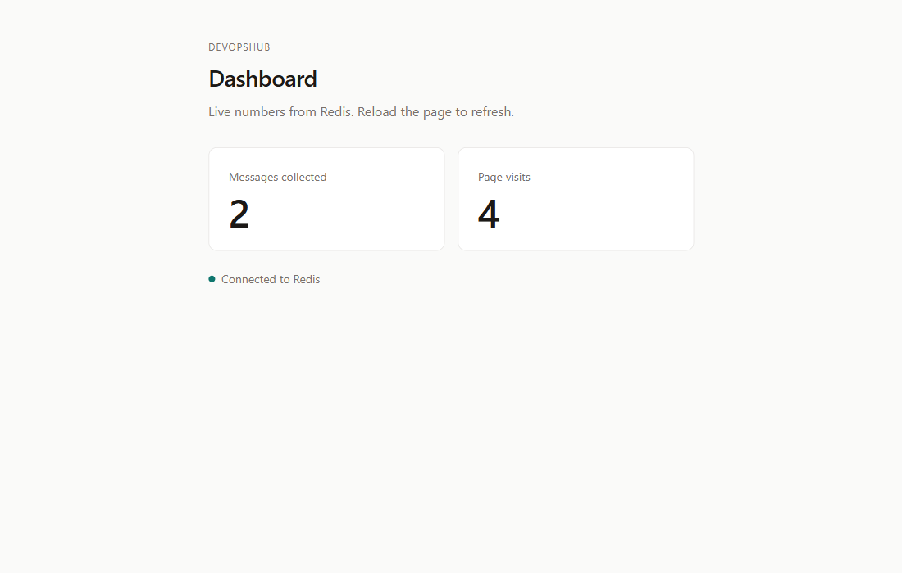

# DevOpsHub: Message Queue + Visit Counter with Redis

Midterm project – Cloud Computing and DevOps Engineering

## 1. Names and IDs

| Name | Student ID |
|---|---|
| Sanad | 4427 |
| Alzubair Alojali | 4426 |

## 2. Code repository

GitHub: https://github.com/alzubair-alojali/devops-mid-project

## 3. Project title and description

**Title:** DevOpsHub: Message Queue + Visit Counter with Redis

**Description:** DevOpsHub is a small system made of two Flask web apps and one Redis database. App 1 is a feedback page. Visitors can send short messages, and the app counts every visit. App 2 is a dashboard. It shows how many messages were collected and how many visits App 1 got. Both apps share the same Redis database. All three services run together with Docker Compose, and the data stays safe in a Docker volume after a restart.

## 4. Architecture

The system has three services. Each service runs in its own container. Compose puts them on one internal network.

| Service | Role | Port on the host |
|---|---|---|
| `redis` | Database: message list + visit counter, saved in a volume | not exposed |
| `app1` | Message Collector: form, counts visits, saves messages | 5001 |
| `app2` | Dashboard: shows message count and visit count | 5002 |

```
Browser --> App 1 (5001) --\
                            >--> Redis (volume redis-data)
Browser --> App 2 (5002) --/
```

The two apps do not talk to each other. They only talk to Redis. Redis is not open to the outside. Only the containers on the Compose network can reach it.

## 5. How the two apps interact with Redis

Both apps use two Redis keys:

- `visits`: an integer counter.
- `messages`: a list of strings.

**App 1 (writes):**

- On each page load (`GET /`), it runs `INCR visits`. This adds 1 to the counter. If the key does not exist, Redis starts it at 0.
- On submit (`POST /submit`), it runs `RPUSH messages <text>`. This adds the message to the end of the list. Empty messages are ignored. Then the app redirects back to `/`.

**App 2 (read-only):**

- On each page load (`GET /`), it runs `LLEN messages` to get the number of messages, and `GET visits` to get the visit count.
- If a key does not exist yet, it shows 0.
- It never writes to Redis. It reads Redis on every request, so a page reload always shows fresh numbers.

**How the apps find Redis:** Each app reads the Redis host from the environment variable `REDIS_HOST`. In `docker-compose.yml` the value is `redis`, which is the service name. Compose has a built-in DNS. It turns the name `redis` into the IP address of the Redis container. So there is no hard-coded IP in the code.

## 6. Prerequisites

- Docker Desktop (includes Docker Engine)
- Docker Compose (included in Docker Desktop, command `docker compose`)
- Git
- A web browser

## 7. Step-by-step solution

**Step 1 – Clone the repository.**

```
git clone https://github.com/alzubair-alojali/devops-mid-project.git
cd devops-mid-project
```

This downloads the project and moves into its folder.

**Step 2 – Look at the project structure.**

```
devops-mid-project/
├── app1/                 Message Collector
│   ├── app.py
│   ├── requirements.txt
│   ├── Dockerfile
│   ├── .dockerignore
│   └── templates/index.html
├── app2/                 Dashboard
│   ├── app.py
│   ├── requirements.txt
│   ├── Dockerfile
│   ├── .dockerignore
│   └── templates/index.html
├── docker-compose.yml    runs all 3 services
└── report/               this report + screenshots
```

Each app has its own code, its own `requirements.txt` and its own `Dockerfile`. `docker-compose.yml` connects everything.

**Step 3 – Build the images and start all services.**

```
docker compose up -d --build
```

`--build` builds the images for App 1 and App 2 from their Dockerfiles. Compose also pulls the `redis:7-alpine` image. `up` creates the network, the volume and the three containers. `-d` runs them in the background.

**Step 4 – Check that all services are running.**

```
docker compose ps
```

All three services (`redis`, `app1`, `app2`) should show the status `Up`.

**Step 5 – Test the apps.**

1. Open http://localhost:5001 (App 1). Reload the page a few times. Write a message and click **Send message**.
2. Open http://localhost:5002 (App 2). It shows the number of messages and the number of visits.
3. Send another message in App 1, then reload App 2. The numbers go up.

**Step 6 – Stop the services.**

```
docker compose down
```

This stops and removes the containers and the network. The volume `redis-data` is **not** removed, so the data is kept.

**Step 7 – Persistence test.**

```
docker compose up -d
```

Open App 2 again. It shows the same numbers as before Step 6. This proves the data was saved in the volume. (Only `docker compose down -v` deletes the volume and the data.)

## 8. docker-compose.yml

```yaml
services:
  redis:
    image: redis:7-alpine
    command: ["redis-server", "--appendonly", "yes"]   # write every change to disk
    volumes:
      - redis-data:/data                               # named volume keeps data after restarts
    restart: unless-stopped

  app1:
    build: ./app1
    image: devopshub-app1
    environment:
      REDIS_HOST: redis                                # service name, resolved by Compose DNS
    ports:
      - "5001:5000"
    depends_on:
      - redis
    restart: unless-stopped

  app2:
    build: ./app2
    image: devopshub-app2
    environment:
      REDIS_HOST: redis
    ports:
      - "5002:5000"
    depends_on:
      - redis
    restart: unless-stopped

volumes:
  redis-data:
```

**Explanation:**

- **volumes:** `redis-data` is a named volume. It is mounted at `/data` in the Redis container. Redis saves its data there. The volume lives outside the container, so the data stays when the container is removed. `--appendonly yes` makes Redis write every change to disk in `/data`.
- **environment:** `REDIS_HOST: redis` tells each app where Redis is. `redis` is the service name, and Compose DNS turns it into the container's address.
- **depends_on:** Compose starts `redis` before `app1` and `app2`. It only controls the start order.
- **ports:** `"5001:5000"` maps port 5001 on the host to port 5000 in the App 1 container. App 2 uses `"5002:5000"`. Both apps listen on 5000 inside their containers. Redis has no `ports`, so it is not reachable from outside.
- **build / image:** `build` tells Compose which folder has the Dockerfile. `image` is the name given to the built image.
- **restart: unless-stopped:** the container restarts if it crashes, unless we stop it ourselves.

## 9. Dockerfile for Web App 1

```dockerfile
FROM python:3.12-slim
WORKDIR /app
COPY requirements.txt .
RUN pip install --no-cache-dir -r requirements.txt
COPY . .
EXPOSE 5000
CMD ["python", "app.py"]
```

**Line by line:**

1. `FROM python:3.12-slim` – start from a small official Python 3.12 image.
2. `WORKDIR /app` – create the folder `/app` and use it for the next commands.
3. `COPY requirements.txt .` – copy only the list of libraries first.
4. `RUN pip install --no-cache-dir -r requirements.txt` – install Flask and the Redis client. `--no-cache-dir` keeps the image smaller.
5. `COPY . .` – copy the rest of the app code (`app.py`, `templates/`).
6. `EXPOSE 5000` – document that the app listens on port 5000.
7. `CMD ["python", "app.py"]` – the command that runs when the container starts.

**Why this order:** `requirements.txt` is copied before the code. Docker caches each step as a layer. When only the code changes, Docker reuses the cached `pip install` layer, so rebuilds are fast.

`.dockerignore` keeps `__pycache__/`, `*.pyc` and `.venv/` out of the image.

## 10. Dockerfile for Web App 2

```dockerfile
FROM python:3.12-slim
WORKDIR /app
COPY requirements.txt .
RUN pip install --no-cache-dir -r requirements.txt
COPY . .
EXPOSE 5000
CMD ["python", "app.py"]
```

**Line by line:**

1. `FROM python:3.12-slim` – start from a small official Python 3.12 image.
2. `WORKDIR /app` – create the folder `/app` and use it for the next commands.
3. `COPY requirements.txt .` – copy only the list of libraries first.
4. `RUN pip install --no-cache-dir -r requirements.txt` – install Flask and the Redis client. `--no-cache-dir` keeps the image smaller.
5. `COPY . .` – copy the dashboard code (`app.py`, `templates/`).
6. `EXPOSE 5000` – document that the app listens on port 5000.
7. `CMD ["python", "app.py"]` – the command that runs when the container starts.

It uses the same order as App 1 for the same reason: the `pip install` layer is cached when only the code changes.

## 11. Docker images

- App 1: https://hub.docker.com/r/alzubairalojali/devopshub-app1 (`docker pull alzubairalojali/devopshub-app1:1.0`)
- App 2: https://hub.docker.com/r/alzubairalojali/devopshub-app2 (`docker pull alzubairalojali/devopshub-app2:1.0`)
- Redis: official image `redis:7-alpine` (https://hub.docker.com/_/redis)

## 12. Access instructions

After `docker compose up -d --build`:

- App 1 (Message Collector): http://localhost:5001
- App 2 (Dashboard): http://localhost:5002

## 13. Screenshots

**1. `docker compose ps` with all 3 services Up**



**2. App 1 in the browser**



**3. App 2 in the browser**



## 14. Persistence proof

We tested that the data survives a restart. We opened App 1 three times and sent two messages. Then we stopped the containers with `docker compose down` (without `-v`) and started them again with `docker compose up -d`.

| | Messages | Visits |
|---|---|---|
| Before `docker compose down` | 2 | 3 |
| After `docker compose up -d` | 2 | 3 |

The numbers are the same, so the data was kept. The data is stored in the named volume `redis-data`. `docker compose down` removes the containers but not the volume. The data is only lost with `docker compose down -v`, which deletes the volume.
